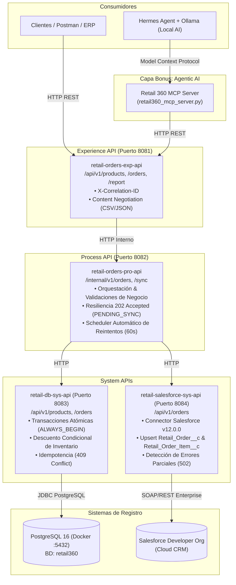

# Proyecto Integrador Final: Retail 360 (Enterprise Edition)

> **Evaluación Skala - Puntuación Objetivo: 100/100 + Bonus Agentic AI**  
> **Desarrollador:** Emmanuel Sánchez  
> **Arquitectura:** API-Led Connectivity en MuleSoft 4, PostgreSQL 16 (Docker), Salesforce CRM (OAuth 2.0 Client Credentials) y Model Context Protocol (MCP).  
> **🎥 Video Demostrativo End-to-End (YouTube - 9 min):** [https://youtu.be/qv3NHCh6BxQ](https://youtu.be/qv3NHCh6BxQ)  
> **📄 Reporte Técnico Ejecutivo y Troubleshooting (PDF):** [`Reporte_Tecnico_Ejecutivo_Retail360_Emmanuel_Sanchez.pdf`](./Reporte_Tecnico_Ejecutivo_Retail360_Emmanuel_Sanchez.pdf) | [`evidencias/EVIDENCIAS_CA01_CA12.md`](./evidencias/EVIDENCIAS_CA01_CA12.md)

---

## 🏛️ 1. Arquitectura de Integración API-Led

El sistema sigue estrictamente los principios de **MuleSoft API-Led Connectivity**, separando responsabilidades en tres capas desacopladas con seguridad Zero-Trust:



---

## 📋 2. Matriz de Casos de Aceptación (CA-01 a CA-12)

| Caso | Escenario | Método / Endpoint | Código Esperado | Criterio de Éxito |
| :--- | :--- | :--- | :---: | :--- |
| **CA-01** | Consultar producto existente | `GET /api/v1/products/LAP-001` | `200 OK` | Devuelve datos de PostgreSQL, precio `18000.00`, stock `12`, `active: true`. |
| **CA-02** | Alta de orden exitosa sincronizada | `POST /api/v1/orders` (`ORD-1001`) | `201 Created` | Calcula total `$37,050.00`, descuenta inventario en BD y sincroniza con Salesforce (`SYNCED`). |
| **CA-03** | Consultar orden creada | `GET /api/v1/orders/ORD-1001` | `200 OK` | Devuelve detalle de cabecera y 2 líneas con `salesforceId` asignado por CRM. |
| **CA-04** | Idempotencia | `POST /api/v1/orders` (`ORD-1001`) | `409 Conflict` | Rechaza duplicado con `ORDER_ALREADY_EXISTS` sin doble descuento de stock. |
| **CA-05** | Validación de cantidad | `POST /api/v1/orders` (`quantity = 0`) | `400 Bad Request` | Rechaza orden con código `INVALID_QUANTITY`. |
| **CA-06** | Validación producto inexistente | `POST /api/v1/orders` (`XXX-999`) | `404 Not Found` | Rechaza orden con código `PRODUCT_NOT_FOUND`. |
| **CA-07** | Validación stock insuficiente | `POST /api/v1/orders` (`MON-001`) | `409 Conflict` | Stock agotado (0); ejecuta rollback automático en BD (`INSUFFICIENT_STOCK`). |
| **CA-08** | SKUs repetidos en el pedido | `POST /api/v1/orders` (`CAM-001` x 2) | `400 Bad Request` | Detecta duplicidad antes de BD con código `DUPLICATE_SKU`. |
| **CA-09** | Contingencia Salesforce caído | `POST /api/v1/orders` (`ORD-1006`) | `202 Accepted` | La orden se persiste en BD con `PENDING_SYNC` y stock descontado (no bloquea venta). |
| **CA-10** | Reintento de sincronización | `POST /internal/v1/orders/{id}/sync` | `200 OK` | Sincroniza pedido pendiente a Salesforce y actualiza BD a `SYNCED` sin descontar doble stock. |
| **CA-11** | Reporte consolidado en CSV | `GET /api/v1/orders/report` | `200 OK` | Retorna `text/csv; charset=UTF-8` con fila única de encabezados y líneas desglosadas. |
| **CA-12** | Manejo de fallo parcial Salesforce | `PUT /api/v1/orders/{id}` | `502 Bad Gateway` | Si falla alguna línea en Salesforce, rechaza con código `SALESFORCE_PARTIAL_ERROR`. |

---

## 🗄️ 3. Estructura del Repositorio

```text
├── database/                                  # Infraestructura de Base de Datos
│   ├── docker-compose.yml                     # Contenedor postgres:16-alpine (:5432)
│   └── init.sql                               # DDL, índices y datos semilla
├── salesforce/                                # Definición y Metadatos de Salesforce (SFDX)
│   ├── force-app/main/default/objects/        # Custom Objects: Retail_Order__c y Retail_Order_Item__c
│   ├── manifest/package.xml                   # Manifiesto de extracción
│   └── README.md                              # Documentación de objetos y diagrama ER
├── postman/                                   # Pruebas End-to-End
│   ├── Retail360_Skala_Collection.json        # Colección Postman (CA-01 a CA-12)
│   ├── Retail360_Local.postman_environment.json # Variables de entorno
│   └── run_ca_tests.ps1                       # Runner automatizado en PowerShell
├── retail-orders-exp-api/                     # Experience API (:8081)
│   └── src/test/munit/                        # Suite de 6 pruebas MUnit (3.7.3)
├── retail-orders-pro-api/                     # Process API (:8082)
├── retail-db-sys-api/                         # Database System API (:8083)
├── retail-salesforce-sys-api/                 # Salesforce System API (:8084)
├── evidencias/                                # Carpeta de Entregables de Evaluación
│   ├── capturas/                              # Evidencias fotográficas requeridas
│   └── EVIDENCIAS_CA01_CA12.md                # Reporte detallado de pruebas
└── bonus-mcp-agent/                           # Bonus Diferencial de Inteligencia Artificial
    ├── retail360_mcp_server.py                # Servidor Model Context Protocol (MCP)
    ├── hermes_agent_demo.py                   # Demo interactiva con Hermes Agent + Ollama
    └── README.md                              # Guía del agente autónomo
```

---

## 🚀 4. Guía de Puesta en Marcha

### Paso 1: Levantar PostgreSQL en Docker
```bash
cd database
docker compose up -d
```

### Paso 2: Ejecutar las APIs en Anypoint Studio
1. En Anypoint Studio, abrir los 4 proyectos principales (`retail-orders-exp-api`, `retail-orders-pro-api`, `retail-db-sys-api`, `retail-salesforce-sys-api`) y el 5to proyecto bonus (`retail-orders-mcp-server`).
2. En las configuraciones de ejecución (**Run Configurations > Arguments > VM arguments**), agregar con prefijo `-M-D` (requerido por el wrapper Tanuki de Mule):
   ```text
   -M-Dmule.env=dev -M-DSFDC_CLIENT_ID=TuConsumerKey -M-DSFDC_CLIENT_SECRET=TuConsumerSecret -M-DSFDC_TOKEN_URL=https://tu-dominio.develop.my.salesforce.com/services/oauth2/token
   ```
3. Ejecutar las APIs y verificar en consola que todas estén en estado **`DEPLOYED`**.

### Paso 3: Preparar Estado Limpio y Ejecutar la Suite de Pruebas (`CA-01` a `CA-12`)
```powershell
python postman/prepare_clean_tests.py --mode selective
./postman/run_ca_tests.ps1
```
También puede importarse [`postman/Retail360_Skala_Collection.postman_collection.json`](./postman/Retail360_Skala_Collection.postman_collection.json) y [`postman/Retail360_Local.postman_environment.json`](./postman/Retail360_Local.postman_environment.json) directamente en Postman Desktop.

### Paso 4: Ejecutar Suite MUnit (6 Tests)
En Anypoint Studio, hacer clic derecho sobre `retail-orders-exp-api` -> **Run As** -> **MUnit Suite**.
Verificar la barra verde con **6/6 pruebas exitosas (0 Errors, 0 Failures)**.

### Paso 5: Bonus Agentic AI (Hermes Agent / Ollama)
```bash
python bonus-mcp-agent/hermes_agent_demo.py
```

---

## ⚙️ 5. Variables de Entorno, Puertos y Orden de Ejecución

### Orden Recomendado de Despliegue (Bottom-Up API-Led)
1. **Base de Datos (`PostgreSQL 16`):** Puerto `5432` (`database/docker-compose.yml` + `database/init.sql`).
2. **System Layer — `retail-db-sys-api`:** Puerto `8083` (Acceso exclusivo a PostgreSQL).
3. **System Layer — `retail-salesforce-sys-api`:** Puerto `8084` (Acceso exclusivo a Salesforce CRM vía OAuth 2.0 Client Credentials).
4. **Process Layer — `retail-orders-pro-api`:** Puerto `8082` (Orquestador de negocio y Scheduler de contingencia cada 60s).
5. **Experience Layer — `retail-orders-exp-api`:** Puerto `8081` (Exposición pública REST, validación RAML y generación CSV).
6. **Bonus Agentic Layer — `retail-orders-mcp-server`:** Puerto `8085` / Bridge STDIO (`bonus-mcp-agent/retail360_mcp_server.py`).

### Tabla de Variables de Configuración / Entorno
| Proyecto | Variable / Propiedad | Valor por Defecto (Local) | Descripción |
| :--- | :--- | :--- | :--- |
| Todas las APIs | `mule.env` | `dev` | Selector del archivo `config/${mule.env}-properties.yaml`. |
| `retail-db-sys-api` | `DB_HOST` / `DB_PORT` | `localhost` / `5432` | Host y puerto del contenedor PostgreSQL. |
| `retail-db-sys-api` | `DB_NAME` / `DB_USER` | `retail360` / `postgres` | Nombre de base de datos y usuario JDBC. |
| `retail-db-sys-api` | `DB_PASSWORD` | `postgres` (parametrizable) | Contraseña de PostgreSQL inyectada por propiedad/entorno. |
| `retail-salesforce-sys-api` | `SFDC_CLIENT_ID` | `YOUR_SFDC_CLIENT_ID` | Consumer Key de la External Client App en Salesforce. |
| `retail-salesforce-sys-api` | `SFDC_CLIENT_SECRET` | `YOUR_SFDC_CLIENT_SECRET` | Consumer Secret de la External Client App en Salesforce. |
| `retail-salesforce-sys-api` | `SFDC_TOKEN_URL` | `https://<my-domain>.develop.my.salesforce.com/services/oauth2/token` | Endpoint OAuth 2.0 Client Credentials de Salesforce. |

---

## 🛡️ 6. Decisiones Técnicas: `On Error Propagate`, `On Error Continue` y `Until Successful` vs `Scheduler`

Conforme a los criterios de calidad de la **Sección 11** de la evaluación, a continuación se documentan las decisiones arquitectónicas de manejo de errores, transacciones y reintentos:

### 6.1. Uso de `On Error Propagate` (Rollback Transaccional en PostgreSQL)
* **Ubicación:** `retail-db-sys-api/src/main/mule/implementation/imp-orders.xml` (dentro del bloque `<try transactionalAction="ALWAYS_BEGIN">`).
* **Justificación:** La creación de la orden (`INSERT INTO retail_orders`), la inserción de sus líneas (`INSERT INTO retail_order_items`) y el descuento de inventario (`SELECT ... FOR UPDATE` + `UPDATE products SET stock = stock - :quantity`) deben ejecutarse como una **unidad atómica ACID** (`RF-04`). Si ocurre cualquier fallo en medio del bucle (por ejemplo, la segunda línea del pedido no tiene stock suficiente en `CA-07` o el `orderId` ya existe en `CA-04`), el bloque interno ejecuta `<on-error-propagate type="ANY">`. En Mule 4, propagar el error fuera de un `<try transactionalAction="ALWAYS_BEGIN">` instruye inmediatamente al *Transaction Manager* de JDBC a ejecutar un **`ROLLBACK`** completo en PostgreSQL, garantizando que nunca queden cabeceras huérfanas ni descuentos parciales de stock.

### 6.2. Uso de `On Error Continue` (Normalización de Contratos y Continuidad de Negocio)
* **Ubicación:**
  1. En el bloque `<try>` externo de `retail-db-sys-api` (que envuelve al `<try>` transaccional) y en los flujos principales de APIKit Router de las 4 APIs.
  2. En los subflujos clientes `client_request_retailSalesforceSysApiSub_Flow`, `client_request_retailDbSysApiSub_Flow` y `client_request_retailOrderProApiSub_Flow`.
* **Justificación:**
  * Una vez que el `On Error Propagate` interno ya revirtió la transacción de base de datos, el `<try>` externo captura la excepción mediante `<on-error-continue>` para transformarla en el contrato estándar `ErrorResponse` JSON (`400`, `404`, `409`, `502`, `503`) junto con el `X-Correlation-ID` (`RF-11`).
  * **Continuidad de Negocio ante Caída de Salesforce (`RF-07` / `CA-09`):** La transacción de PostgreSQL finaliza y hace `COMMIT` **antes** de que `retail-orders-pro-api` invoque a `retail-salesforce-sys-api`. Si Salesforce no está disponible (`503`) o rechaza registros (`502`), `client_request_retailSalesforceSysApiSub_Flow` captura el fallo con `On Error Continue`, permitiendo que `retail-orders-pro-api` conserve la venta, marque la orden como `PENDING_SYNC` vía `PATCH /orders/{orderId}/sync` y responda **`202 Accepted`** al cliente sin perder el pedido ni revertir el inventario.

### 6.3. Estrategia de Reintentos: `Scheduler` + `/sync` vs `Until Successful`
* **Decisión:** En lugar de envolver la llamada de creación de orden o el Upsert de Salesforce en un scope `<until-successful>` bloqueante en memoria durante el `POST /orders`, se implementó un **patrón de desacoplamiento basado en estado persistido (`PENDING_SYNC`)** combinado con:
  1. El endpoint de recuperación `POST /internal/v1/orders/{orderId}/sync` (`imp-sync-orderSub_Flow`).
  2. El flujo programado `scheduler-retry-pending-ordersFlow` (`<scheduler>` cada 60 segundos) que consulta `GET /api/v1/orders?status=PENDING_SYNC` y reintenta únicamente la sincronización hacia Salesforce.
* **Ventajas sobre `Until Successful` síncrono:**
  * **Cero riesgo de doble descuento de stock:** Cumple estrictamente la restricción *"No se deben reintentar operaciones de alta de pedido para recuperar fallas de Salesforce"*. El reintento lee la orden ya persistida en PostgreSQL y solo ejecuta el Upsert idempotente (`External_Order_Id__c` y `External_Line_Id__c`) hacia Salesforce.
  * **Tolerancia a reinicios y no bloqueo de hilos HTTP:** Si Salesforce sufre una caída de varios minutos, un `Until Successful` retendría hilos del pool HTTP y perdería los reintentos si el runtime se reinicia. Al persistir `PENDING_SYNC`, `sync_attempts` y `last_sync_error` en PostgreSQL, la orden sobrevive a reinicios y se sincroniza automáticamente en cuanto Salesforce vuelve a estar en línea.

---

## ☁️ 7. Configuración Descriptiva de Salesforce CRM (Sin Secretos)

La especificación completa de los objetos personalizados, campos, tipos de datos, relaciones y manifiesto SFDX (`package.xml`) se encuentra documentada en [`salesforce/README.md`](./salesforce/README.md):
* **Objeto Cabecera:** `Retail_Order__c` con clave externa única `External_Order_Id__c` (`Text(50)`, *External ID*, *Unique*).
* **Objeto Detalle (Líneas):** `Retail_Order_Item__c` con clave externa única `External_Line_Id__c` (`Text(100)`, *External ID*, *Unique*, formato `orderId + "-" + sku`) y relación `Order__c` hacia `Retail_Order__c`.
* **Manejo de Errores Parciales (`CA-12`):** `retail-salesforce-sys-api` inspecciona individualmente el resultado de `<salesforce:upsert>` tanto de la cabecera como de cada elemento en `vars.itemsUpsertResult.items`. Únicamente si `successful == true` en la cabecera y en el **100% de las líneas**, devuelve `200 OK` (`SYNCED`). Si una sola línea falla, lanza `APP:SALESFORCE_REJECTED` (`502 Bad Gateway`), manteniendo la orden en `PENDING_SYNC` para reintento seguro.


