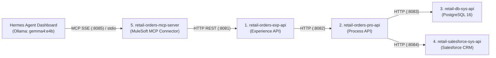

# Bonus Agentic AI: Servidor MCP Nativo en Anypoint Studio + Hermes Agent Dashboard (`gemma4:e4b`)

Este componente diferencial demuestra la integración de vanguardia entre **MuleSoft 4 (API-Led Connectivity)** y **Agentes de IA Locales (Hermes Agent + Ollama con el modelo `gemma4:e4b`)** a través del estándar **Model Context Protocol (MCP)**.



---

## 🔒 Garantía de Desacoplamiento (Zero-Coupling)
- Las **4 APIs principales (`8081`, `8082`, `8083`, `8084`)** son **100% independientes** del servidor MCP.
- Si se evalúan únicamente los 4 proyectos obligatorios de Skala, funcionan sin ninguna dependencia hacia el 5to proyecto.

---

## 🖥️ Configuración en el Dashboard de Hermes Agent (`gemma4:e4b`)

### Opción 1: Conexión SSE hacia Anypoint Studio (`retail-orders-mcp-server` en puerto `8085`)
Si tu Dashboard de Hermes Agent soporta servidores MCP por red (**SSE / HTTP**):
- **Server Name:** `retail360-mulesoft-mcp`
- **Transport:** `SSE`
- **URL:** `http://localhost:8085/sse`
- **Model (Ollama):** `gemma4:e4b`

### Opción 2: Conexión STDIO en el Dashboard de Hermes Agent
Si en el Dashboard de Hermes Agent registras el servidor por comando (`stdio`), pega esta configuración en el bloque de servidores MCP de Hermes:

```json
{
  "mcpServers": {
    "retail360-mulesoft": {
      "command": "python",
      "args": [
        "c:/Users/emman/AnypointStudio/studio-workspace/bonus-mcp-agent/retail360_mcp_server.py"
      ]
    }
  }
}
```

---

## 💬 Prompts Sugeridos para Demostración en el Dashboard de Hermes (`gemma4:e4b`)

Una vez activo el modelo **`gemma4:e4b`** en el Dashboard de Hermes Agent y desplegadas tus APIs en Anypoint Studio, prueba estos mensajes en el chat de Hermes para tus capturas de pantalla:

1. **Consulta de Inventario en Vivo:**
   > *"Hola Hermes, consulta en MuleSoft el producto con SKU LAP-001 y dime cuánto cuesta y cuántas unidades hay en stock."*
2. **Creación de Orden Transaccional + Sincronización con Salesforce:**
   > *"Crea un pedido con orderId ORD-HERMES-01 para el cliente Emmanuel Sanchez (ID: CUST-AI-01, correo: emmanuel@skala.io) con 1 unidad del SKU LAP-001 y 2 unidades de MOU-001."*
3. **Verificación de Estado en Salesforce:**
   > *"Consulta el pedido ORD-HERMES-01 y confírmame cuál es su salesforceId y su estado de sincronización."*
4. **Reporte Ejecutivo:**
   > *"Obtén el reporte consolidado de todas las órdenes de Retail 360."*
