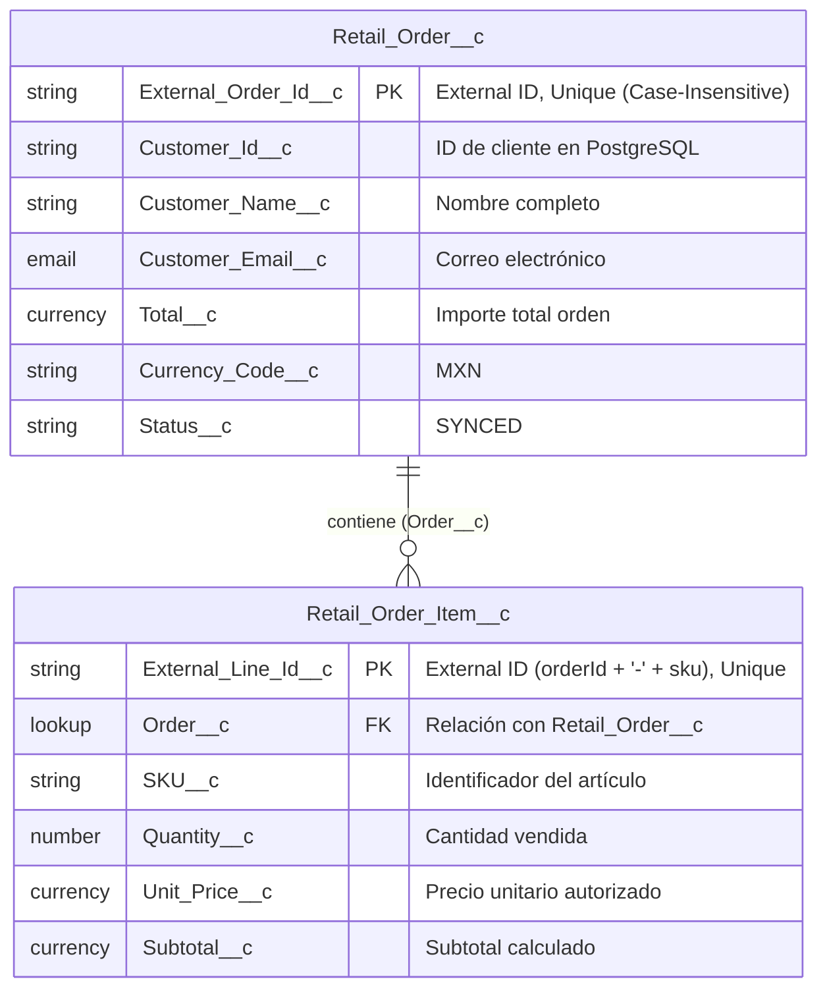

# ☁️ Salesforce Custom Objects & Data Model - Retail 360

Este directorio contiene la definición completa de metadatos (formato SFDX / Metadata API v60.0) extraída directamente de la Salesforce Developer Edition utilizada para la integración con **MuleSoft 4** (`retail-salesforce-sys-api`).

---

## 1. Modelo de Datos Entidad-Relación



---

## 2. Especificación de Objetos y Campos

### Objeto: `Retail_Order__c` (`Retail Order`)
* **API Name:** `Retail_Order__c`
* **Campos Personalizados:**
  * `External_Order_Id__c`: `Text(50)`, marcado como **External ID** y **Unique** (Case-Insensitive). Permite operaciones **Upsert idempotentes** desde MuleSoft.
  * `Customer_Id__c`: `Text(50)`
  * `Customer_Name__c`: `Text(120)`
  * `Customer_Email__c`: `Email`
  * `Total__c`: `Currency(10, 2)`
  * `Currency_Code__c`: `Text(10)`
  * `Status__c`: `Text(20)`

### Objeto: `Retail_Order_Item__c` (`Retail Order Item`)
* **API Name:** `Retail_Order_Item__c`
* **Campos Personalizados:**
  * `External_Line_Id__c`: `Text(100)`, marcado como **External ID** y **Unique** (Case-Insensitive). Formato: `${orderId}-${sku}`.
  * `Order__c`: `Lookup(Retail_Order__c)` hacia la cabecera.
  * `SKU__c`: `Text(30)`
  * `Quantity__c`: `Number(10, 0)`
  * `Unit_Price__c`: `Currency(10, 2)`
  * `Subtotal__c`: `Currency(10, 2)`

---

## 3. Estructura de Metadatos en este Repositorio

```text
salesforce/
├── sfdx-project.json
├── manifest/
│   └── package.xml
└── force-app/
    └── main/
        └── default/
            └── objects/
                ├── Retail_Order__c/
                │   ├── Retail_Order__c.object-meta.xml
                │   └── fields/
                │       ├── Currency_Code__c.field-meta.xml
                │       ├── Customer_Email__c.field-meta.xml
                │       ├── Customer_Id__c.field-meta.xml
                │       ├── Customer_Name__c.field-meta.xml
                │       ├── External_Order_Id__c.field-meta.xml
                │       ├── Status__c.field-meta.xml
                │       └── Total__c.field-meta.xml
                └── Retail_Order_Item__c/
                    ├── Retail_Order_Item__c.object-meta.xml
                    └── fields/
                        ├── External_Line_Id__c.field-meta.xml
                        ├── Order__c.field-meta.xml
                        ├── Quantity__c.field-meta.xml
                        ├── SKU__c.field-meta.xml
                        ├── Subtotal__c.field-meta.xml
                        └── Unit_Price__c.field-meta.xml
```

